# Afno Parcel — Database design (Phase 2)

SQL Server, Entity Framework Core 10, code-first. Business tables are in schema **`parcel`**, ASP.NET Core Identity and
refresh tokens in schema **`identity`**. The EF Core configuration for each table is in
`src/NepalParcel.Infrastructure/Persistence/Configurations/` (Fluent API only — no data annotations on entities).

## Entity relationships

```mermaid
erDiagram
    Users ||--o| Customers : "online login (UserId)"
    Users ||--o| DeliveryAgents : "agent login (UserId)"
    Users ||--o{ RefreshTokens : "sessions"
    Users }o--o{ Roles : "UserRoles"

    Branches ||--o{ Warehouses : "operates"
    Branches ||--o{ DeliveryAgents : "employs"
    Branches ||--o{ ServiceAreas : "serves"
    Branches ||--o{ CODSettlements : "receives cash"

    Customers ||--o{ Parcels : "sends"
    Customers ||--o{ CustomerConsents : "decisions"
    Customers ||--o{ Payments : "pays"

    ParcelStatuses ||--o{ Parcels : "current status"
    ParcelStatuses ||--o{ ParcelStatusHistory : "from / to"
    Parcels ||--|{ ParcelItems : "contains"
    Parcels ||--|{ ParcelStatusHistory : "timeline (append-only)"
    Parcels ||--o{ DeliveryAssignments : "legs / attempts"
    Parcels ||--o{ DeliveryProofs : "evidence"
    Parcels ||--o{ Payments : "charges"
    Parcels ||--o| CODCollections : "cash collected once"
    Parcels ||--o{ NotificationOutbox : "events"
    Branches ||--o{ Parcels : "origin / destination / current"
    Warehouses ||--o{ Parcels : "currently held / next warehouse"

    Users ||--o{ StaffAssignments : "works at (one active)"
    Branches ||--o{ StaffAssignments : "staffed by"
    Warehouses ||--o{ StaffAssignments : "optionally one warehouse"
    Parcels ||--o{ ParcelMovements : "arrivals and departures (append-only)"
    Warehouses ||--o{ ParcelMovements : "at / heading to"
    Parcels ||--o{ ParcelScans : "scan log (append-only)"
    DeliveryAssignments ||--o{ DeliveryOtps : "one-time delivery codes"
    CODSettlements ||--o{ CODCollections : "cash handed in"
    ParcelMovements ||--o{ ParcelScans : "created / repeated by"

    DeliveryAgents ||--o{ DeliveryAssignments : "works"
    DeliveryAssignments ||--o{ DeliveryProofs : "captured during"
    DeliveryAgents ||--o{ CODCollections : "collects"
    CODSettlements ||--o{ CODCollections : "batches"

    Payments ||--o{ PaymentTransactions : "gateway attempts"
    NotificationOutbox ||--o{ NotificationLogs : "attempts and provider reports"

    ServiceAreas ||--o{ PricingRules : "from / to"
```

`WebhookEvents` and `AuditLogs` have no foreign keys by design (see below).

## Tables

| Table | Purpose | Notes |
|-------|---------|-------|
| `Branches` | Head office and branch counters | Unique `Code`; Nepal address columns; rowversion |
| `Warehouses` | Storage/sorting hubs, each belonging to a branch | Unique `Code` |
| `Customers` | Senders. Online customers link to a login; walk-ins have `UserId = NULL` | One profile per user (filtered unique index) |
| `CustomerConsents` | Consent history (terms, privacy, SMS, email, marketing) | Immutable rows; withdrawing adds a new row |
| `ParcelStatuses` | Lookup of the 11 statuses | Seeded; ids = `ParcelStatusCode` enum |
| `Parcels` | The booking: sender, receiver, route, service, weight, money, COD | **Unique `TrackingNumber`**; rowversion; check constraints |
| `ParcelItems` | What is inside a parcel | Quantity/weight check constraints |
| `ParcelStatusHistory` | Every status change with who/where/when | **Append-only**; index `(ParcelId, OccurredAtUtc)` |
| `StaffAssignments` | Which branch (and optionally warehouse) each staff member works at | History kept: ended rows stay. Filtered unique index: one *active* row per user. See [network.md](network.md) |
| `ParcelMovements` | Warehouse arrivals, departures and hand-overs of a parcel | **Append-only**; indexes `(ParcelId, OccurredAtUtc)` and `(WarehouseId, OccurredAtUtc)` |
| `ParcelScans` | Every scan, including repeated ones (`Applied` / `Duplicate`) | **Append-only**; indexes by parcel, warehouse and staff, each with the time |
| `DeliveryAgents` | Riders/drivers (linked to a login and a branch) | Unique `UserId` |
| `DeliveryAssignments` | Pickup / delivery / return tasks and attempts | Filtered unique index: one *open* assignment per parcel and type. See [delivery.md](delivery.md) |
| `DeliveryProofs` | Signature / photo / OTP evidence | Files referenced by private `StorageKey`, never a public URL. **Append-only** |
| `DeliveryOtps` | One-time codes sent to the receiver at the door | Only a keyed hash is stored; lifetime, attempt limit; index `(AssignmentId, CreatedAtUtc)` |
| `Payments` | Amount owed/paid per parcel (NPR) | `Amount > 0` check; rowversion |
| `PaymentTransactions` | The ledger: every online attempt and every payment taken by a person | Unique `MerchantReference` (our reference); unique `(Provider, ProviderReference)` once the provider's reference is known. See [payments.md](payments.md) |
| `TestGatewaySessions` | The books of the **simulated** eSewa/Khalti (test mode only) | Unique `MerchantReference` and `ProviderTransactionId` |
| `CODCollections` | Cash collected on delivery | Unique per parcel; rowversion. Stays *collected* until the accountant's count is accepted |
| `CODSettlements` | Batch hand-over of COD cash to the accountant, with the counted amount and the variance | Unique `ReferenceNumber`; rowversion |
| `NotificationOutbox` | Transactional outbox for SMS and WhatsApp (and one-time codes). `Status` is what we did (pending, submitted, failed, dead letter, skipped…); `DeliveryStatus` is only what the provider reported; sent / delivered / read / failed times are separate columns | Index `(Status, NextAttemptAtUtc)` for the worker; unique `(DedupeKey, Audience, Channel)` (an event is queued once); unique `(Provider, ProviderMessageId)`; rowversion. See [notifications.md](notifications.md) |
| `NotificationLogs` | Every attempt to send and every report the provider sent back | Recipient stored **masked**; never updated |
| `NotificationTemplates` | The message texts, per message, channel and language; for WhatsApp the name of the template Meta approved | Unique `(Key, Channel, Language)`; rowversion |
| `NotificationOptOuts` | Numbers that asked not to be messaged on a channel (history kept when lifted) | Unique `(PhoneNumber, Channel)` while in force |
| `MockProviderMessages` | What the mock providers "sent" (the test inbox; development and test only) | Unique `ProviderMessageId` |
| `WebhookEvents` | Inbound provider events (WhatsApp delivery reports and replies) | Unique `(Provider, EventId)` → replays detected |
| `PricingRules` | Price per weight band, service type and area (NPR) | Check constraints; end old rule + add new rule to change a price |
| `ServiceAreas` | Where we deliver, which branch serves it | Unique `Code`; index `(Province, District)` |
| `AuditLogs` | Who did what and when | **Append-only, no foreign keys** |
| `identity.*` | `Users`, `Roles`, `UserRoles`, claims, logins, tokens | ASP.NET Core Identity |
| `identity.RefreshTokens` | Hashed refresh tokens with rotation chain | Unique `TokenHash`; rowversion |

## Design rules

**Money** is always `decimal(18,2)` NPR (never `float`/`double`); weights are `decimal(10,3)` kg; percentages
`decimal(5,2)`. The domain rounds half-away-from-zero to paisa and rejects negatives. `Payment.Currency` is fixed to `NPR`.

**Time** is stored as `datetimeoffset` in **UTC** (`...AtUtc` columns). Nothing is stored in local time. Convert for
display with `NepalTime` (C#) or `formatNepalDateTime` (TypeScript) — Asia/Kathmandu, UTC+05:45, no daylight saving.

**Tracking numbers** look like `AFNK7M2Q9XT4B3`: prefix `AFN`, ten random characters from an unambiguous alphabet and a
check character that catches typing mistakes. Generated with a cryptographic RNG so they cannot be guessed in sequence.
A unique index guarantees uniqueness; on the (extremely unlikely) collision the booking code retries.

**Concurrency**: `rowversion` columns on `Branches`, `Warehouses`, `Customers`, `Parcels`, `DeliveryAgents`,
`DeliveryAssignments`, `Payments`, `CODCollections`, `CODSettlements`, `NotificationOutbox`, `PricingRules` and
`RefreshTokens`. EF Core compares them on every update; a lost race raises `ConcurrencyException`, returned as HTTP 409
(or 401 for a refresh-token race).

**History is preserved**
- Every foreign key is `ON DELETE NO ACTION` (verified: 43 foreign keys, none cascade). A parcel, customer or branch
  that has history cannot be hard-deleted; deactivate (`IsActive`) instead.
- `ParcelStatusHistory`, `ParcelMovements`, `ParcelScans`, `DeliveryProofs`, `PaymentTransactions`, `CustomerConsents`, `NotificationLogs` and `AuditLogs` are never updated.
  A save guard refuses any save that edits or deletes a history, movement or scan row.
- Status history stores a *snapshot* of the staff name, so it stays readable if an account is later changed.
- Status changes go through `Parcel.ChangeStatus`, which enforces the workflow (`ParcelStatusWorkflow`) — e.g. a parcel
  cannot jump from *Booked* to *Delivered* — and adds the history row in the same save.

**Enums** are stored as readable text (`'InTransit'`) so the data is understandable in SQL and safe if enum order changes.

**Indexes** cover the lookups the application needs: tracking number, sender, `(status, booked date)`, origin /
destination / current branch, receiver phone, agent workload, settlement batches, the outbox worker query, audit by
entity / user / time. Filtered unique indexes enforce "one profile per login", "one open assignment per parcel per type"
and "provider reference unique when present".

## Personal data and what may be exposed

Personal data lives in `Customers` (name, phone, email, address), `Parcels` (receiver name, phone, address),
`Users`, `NotificationOutbox` (recipient/payload) and `DeliveryProofs` (recipient name).

- Public endpoints must return only **tracking status and timeline** (no names, phones, emails or full addresses).
  Contracts for public responses will be separate DTOs, so a field cannot leak by accident.
- `/auth/me` returns only the caller's own profile. JWTs contain no phone or address.
- Logs and audit rows hold user **ids** and **masked** values (`s***@example.com`, `98******67`); `CreatedBy` /
  `UpdatedBy` are user ids, not names. Passwords and tokens are never logged or stored in clear.
- Proof images are referenced by a private storage key, never a public URL.
- Not yet done (recommended before production): column-level encryption or SQL Server Always Encrypted for phone and
  address, and a data-retention/erasure job driven by `CustomerConsents`.

## Seed data

Applied by the migration (`HasData`), so every environment gets the same ids:

- **Roles** (`identity.Roles`): SuperAdmin, BranchManager, BookingStaff, WarehouseStaff, DeliveryAgent, Accountant, Customer.
- **ParcelStatuses**: 1 BookingCreated, 2 PickedUp, 3 Shipped, 4 InTransit, 5 ArrivedAtWarehouse, 6 OutForDelivery,
  7 Delivered*, 8 DeliveryFailed, 10 Returned*, 11 Cancelled* (\* terminal). Id 9 is retired and never reused.

No users or credentials are seeded. The only way to create the first administrator is the optional
`Bootstrap:SuperAdmin` configuration described in the README.

## Migrations

| Migration | Contents |
|-----------|----------|
| `InitialCreate` | Phase 1: `Branches` |
| `Phase2_DomainAndIdentity` | Everything above, Identity tables, indexes, constraints, seed data |
| `Phase3_ParcelBooking` | `Parcels` gains the sender snapshot (name, phone, address, instructions), receiver instructions, description, quantity, dimensions, volumetric/chargeable weight, payment method, the price breakdown (base, weight charge, COD fee, VAT %, VAT) and the pricing rule used; new check constraint `CK_Parcels_Booking` and indexes on `SenderPhone` and `BookedAtUtc`. See [booking.md](booking.md). |
| `Phase4_StatusTracking` | New status set (renames ids 1, 3 and 5, removes id 9; ids are never renumbered), new table `TrackingOtps` (hashed one-time codes for receiver verification). Existing history rows keep their ids. See [tracking.md](tracking.md). |
| `Phase8_Notifications` | `NotificationOutbox` gains audience, language, dedupe key, provider and provider message id, rendered text, skip reason, delivery status and the sent / delivered / read / failed times (existing `Sent` rows become `Submitted`; existing rows are marked as receiver messages in English); `NotificationLogs` gains the attempt number and the provider's time; new tables `NotificationTemplates`, `NotificationOptOuts` and `MockProviderMessages`. See [notifications.md](notifications.md). |
| `Phase7_Payments` | `PaymentTransactions` gains `MerchantReference` (existing rows are given a reference before the unique index is built), `Currency`, `ExpiresAtUtc`, `RecordedByUserId`; `CODSettlements` gains `CountedAmount`; new table `TestGatewaySessions`. See [payments.md](payments.md). |
| `Phase6_DeliveryAgents` | New table `DeliveryOtps` (hashed one-time delivery codes) and an index on `DeliveryAssignments (DeliveryAgentId, AssignedAtUtc)` for the agent lists and the performance report. See [delivery.md](delivery.md). |
| `Phase5_BranchWarehouse` | New tables `StaffAssignments`, `ParcelMovements`, `ParcelScans`; `Parcels` gains `StatusChangedAtUtc` (back-filled from each parcel's latest history row, or its creation time) and `NextWarehouseId` (foreign key to `Warehouses`), with indexes for the waiting and inventory lists. See [network.md](network.md). |

Create and apply: see the README. The model for tests (SQLite) differs only in two provider details: `rowversion`
is not generated and `nvarchar(max)` columns use SQLite's default text type.
